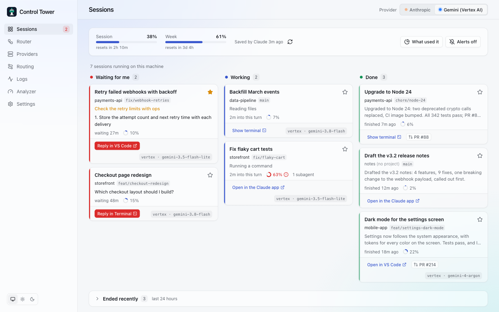
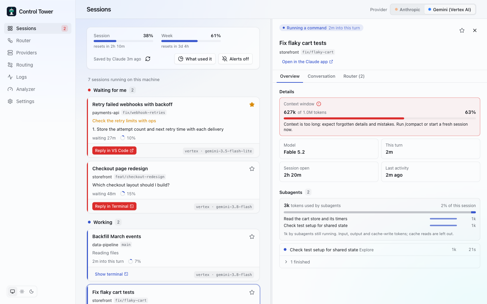
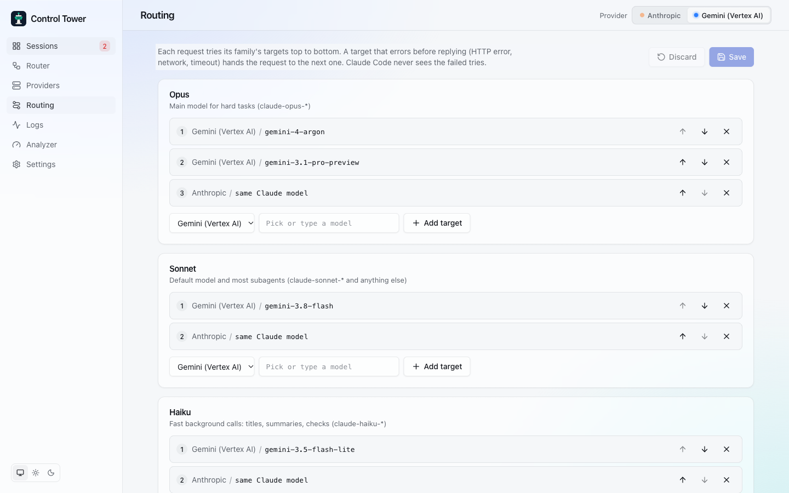
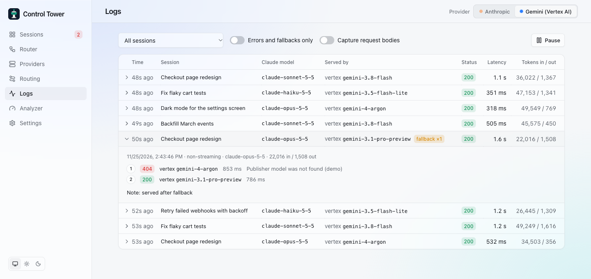
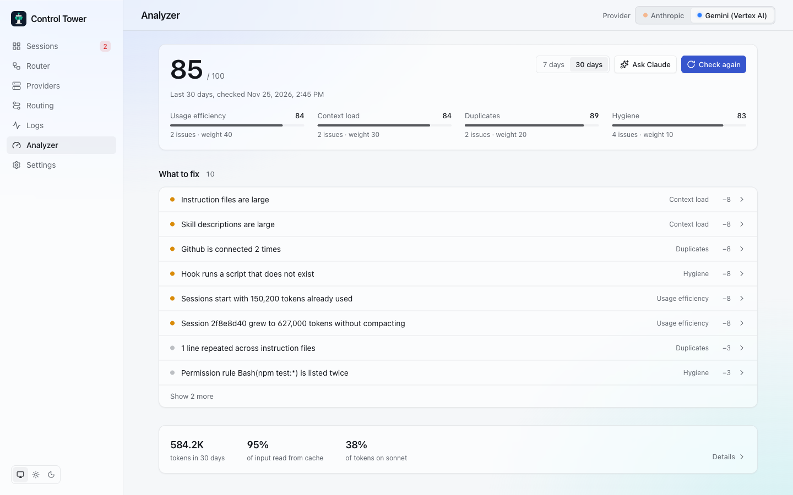

<div align="center">

<picture>
  <source media="(prefers-color-scheme: dark)" srcset="docs/assets/logo-dark.svg">
  
</picture>

# claude-code-control-tower

**Mission control for Claude Code, running entirely on your machine.**

See every Claude Code session at a glance, route models across Anthropic and Gemini with automatic fallback,<br>and tune your setup. No cloud, no telemetry, no accounts.

[](LICENSE)


[Set up](#set-up) · [Tour](#a-quick-tour) · [Everyday use](#everyday-use) · [Security](#security) · [Contributing](CONTRIBUTING.md)

<br>

<picture>
  <source media="(prefers-color-scheme: dark)" srcset="docs/assets/screenshots/sessions-dark.png">
  
</picture>

<sub>Screenshots use made-up data from <code>npm run demo</code>.</sub>

</div>

> **Independent project.** claude-code-control-tower is a personal open-source project. It is not affiliated with, endorsed by or supported by Anthropic or Google. "Claude" and "Claude Code" are trademarks of Anthropic; "Gemini" is a trademark of Google.

## Why claude-code-control-tower

| | |
|---|---|
| 🗂️ **Sessions board** | Every Claude Code session on this machine (terminal, VS Code, Claude desktop app) in one place: who is waiting for you, what is working, what is done, how full each context is, and your plan's usage. Chimes when a session needs you. |
| 🔀 **Model router** | A local proxy Claude Code talks to instead of Anthropic's API. Each request goes to **Anthropic** (unchanged, your own login) or **Google Gemini** (translated, streaming and tools included), following a fallback chain per model family. |
| 🛟 **Automatic fallback** | If a target fails before replying, the next one answers. End each chain with Anthropic and a request always gets answered. |
| 🩺 **Setup analyzer** | Finds what bloats your context and wastes tokens: oversized instructions, duplicate skills and MCP servers, unused setup, broken hooks. |
| 🔒 **Secure by design** | Loopback only, DNS-rebinding protection, write-only keys, prompts kept in memory only, zero telemetry. [Details below](#security). |

```
claude ──► http://127.0.0.1:3456/v1/messages ──► route for opus / sonnet / haiku
                                                   1. vertex/gemini-4-argon          (translated to Gemini)
                                                   2. vertex/gemini-3.1-pro-preview    ↓ on error
                                                   3. anthropic                      (pass-through)
```

The Sessions page works whether or not you route anything: it only reads Claude Code's files. The router only affects sessions you start pointed at it.

## A quick tour

| | |
|---|---|
| <picture><source media="(prefers-color-scheme: dark)" srcset="docs/assets/screenshots/session-panel-dark.png"></picture><br>**Session panel.** Context use with a warning before it gets too long, the model, timings, subagents and the full conversation. | <picture><source media="(prefers-color-scheme: dark)" srcset="docs/assets/screenshots/routing-dark.png"></picture><br>**Routing.** An ordered fallback chain for each model family: Gemini models first, Anthropic last. |
| <picture><source media="(prefers-color-scheme: dark)" srcset="docs/assets/screenshots/logs-dark.png"></picture><br>**Logs.** Every request through the router, with each attempt. Here Gemini 4 Argon failed and Gemini 3.1 Pro answered. | <picture><source media="(prefers-color-scheme: dark)" srcset="docs/assets/screenshots/analyzer-dark.png"></picture><br>**Analyzer.** A score for your Claude Code setup and a list of what to fix, worst first. |

Want to click around first? After `npm install && npm run build`, `npm run demo` starts it on made-up sessions at http://127.0.0.1:3460. It reads none of your files and sends nothing anywhere.

---

## Set up

### 1. Requirements

- macOS, Linux or Windows. Everything works on all three, with two exceptions:
  - **Show terminal** (bring a running session's window forward) is macOS only. **Resume in terminal** works everywhere.
  - Claude desktop app sessions show only where the desktop app runs (macOS and Windows).
- Node.js 22 or newer: `node -v`
- Claude Code installed and logged in (`claude` on your PATH). The usage figures on the Sessions page need a Claude subscription plan.
- For Gemini routing: a Google **Vertex AI express-mode key** (plus its project number) or an **AI Studio key**. Not needed if you only want the Sessions page.

### 2. Install and build

```bash
git clone https://github.com/ndavid-opeak/claude-code-control-tower.git
cd claude-code-control-tower
npm install
npm run build        # builds the dashboard into dist/web; repeat after pulling changes
```

### 3. Start it

```bash
npm start
```

The terminal prints:

```
claude-code-control-tower on http://127.0.0.1:3456  (mode: anthropic)
Connect Claude Code with:  ANTHROPIC_BASE_URL=http://127.0.0.1:3456 claude
```

Open **http://127.0.0.1:3456**. The Sessions page shows straight away. Keep the terminal open; stop with `Ctrl+C`. Use `PORT=5000 npm start` for another port.

### 4. Add a Gemini provider (only for routing)

1. Go to **Providers** → **Add Gemini provider**.
2. Pick the key type:
   - **Vertex AI**: paste the express-mode key, enter the **project** (ID or number), keep location **global** (it has the newest models; regional locations such as `europe-west1` lack some).
   - **AI Studio**: paste the key from aistudio.google.com.
3. **Add and test**. The key is saved to this repo's `.env` (never shown again) and checked with a 1-token call.
4. Press **Probe models** on the provider card to find which models the key can actually call. They become suggestions in Routing.

You can also put the key in `.env` yourself (copy `.env.example`); the provider lists which variable name it reads, `GEMINI_API_KEY` by default.

### 5. Set the routes

On **Routing**, each Claude model family has an ordered list of targets:

| Family | Used by Claude Code for |
|---|---|
| opus | `claude-opus-*` models |
| sonnet | the default model, most subagents, and any model name that is not opus or haiku |
| haiku | fast background calls (titles, summaries, checks) |

Add targets as `provider / model` and order them with the arrows. Ending each list with **Anthropic** means a request still gets answered when Gemini fails. **Save**.

### 6. Choose who answers

The header on every page has two controls:

- **Main provider** (Anthropic, Gemini, …): one click makes that provider answer first for every model family.
  - **Anthropic** switches to pass-through: every request goes to Anthropic unchanged and the routes are ignored. This is the default.
  - **A Gemini provider** turns routing on, enables the provider and moves its targets to the top of each chain; the other targets stay as fallbacks. If the provider has no target for a family you are asked for a model.
  - A **confirmation popup** comes first and shows how many Claude Code sessions are active. The switch applies to the very next request, including running sessions, and a different model may not accept the earlier turns of a conversation, so a session in the middle of a task can fail and need restarting.
- **Now serving** chip: which provider is answering Claude Code. Gemini is blue, Anthropic is orange. It reads **Serving: …** with the model while a reply finished in the last 90 seconds, and dims to **Next: …** when idle. An amber **fallback** badge means the primary failed and a later target answered. It updates when a request finishes, so a long streaming reply shows the previous provider until it ends.

You can still reorder targets per family on **Routing**.

### 7. Point Claude Code at the router

For one session:

```bash
ANTHROPIC_BASE_URL=http://127.0.0.1:3456 claude
```

On Windows (PowerShell): `$env:ANTHROPIC_BASE_URL="http://127.0.0.1:3456"; claude`

For every session, add it to `~/.claude/settings.json` (Claude Code reads `env` from there, including in VS Code):

```json
{
  "env": { "ANTHROPIC_BASE_URL": "http://127.0.0.1:3456" }
}
```

> **Warning: once `ANTHROPIC_BASE_URL` points at the router, ALL of Claude Code's requests go through it, whichever provider answers them. If the router is down, Claude Code does not fall back to Anthropic's own URL: requests fail with "connection refused" and Claude will not work until the router is running again (or you remove the setting and restart `claude`).**

With **Anthropic** as the main provider the router behaves like Anthropic's API, so while it is running, leaving the setting in costs nothing. Your Anthropic login is passed through untouched for Anthropic targets and never sent to Google.

### 8. Start it automatically and keep it running (recommended)

Because Claude Code depends on the router once it points here, run the router so it starts on login and restarts itself if it crashes. Pick your OS below.

#### macOS (launchd)

A launchd LaunchAgent with `RunAtLoad` (start at login) and `KeepAlive` (relaunch whenever the process exits). Install the template in `launchd/com.claude-router.plist` (run from the repo folder, after `npm install`):

```bash
mkdir -p ~/.claude-router ~/Library/LaunchAgents
sed -e "s|__NODE__|$(command -v node)|g" -e "s|__REPO__|$PWD|g" -e "s|__HOME__|$HOME|g" \
  launchd/com.claude-router.plist > ~/Library/LaunchAgents/com.claude-router.plist
launchctl bootstrap gui/$(id -u) ~/Library/LaunchAgents/com.claude-router.plist
```

Check it: `curl -s -o /dev/null -w "%{http_code}\n" http://127.0.0.1:3456/` should print `200`. To see the restart work, run `launchctl kickstart -k gui/$(id -u)/com.claude-router` and check again after a few seconds. Logs go to `~/.claude-router/router.log`.

Or ask Claude Code in this folder to do it for you:

> Set up claude-code-control-tower to launch automatically when I log in and to restart itself if it stops or crashes, using the template in `launchd/`. Then verify it is running on port 3456.

Things to know:

- launchd does not use your shell's `PATH`, so the template takes absolute paths to `node` and to this repo (the `sed` line fills them in). It also puts `claude` on the agent's `PATH` for the Sessions usage check; edit that line if `claude` lives elsewhere.
- While the agent is loaded it owns port 3456, so `npm start` fails with "address already in use". After a code change or `npm run build`, restart it with the `kickstart` command above.
- After a restart the request log and captured bodies are empty (they live in memory only); providers, routes and keys are kept.
- To stop it for good, unload the agent (`launchctl bootout gui/$(id -u)/<label>`) and delete its plist; otherwise `KeepAlive` brings it straight back.
- If the router still cannot start, Claude Code stays blocked until you fix it or remove `ANTHROPIC_BASE_URL`.

#### Linux (systemd user service)

Install the template in `autostart/linux/` (run from the repo folder, after `npm install`):

```bash
mkdir -p ~/.claude-router ~/.config/systemd/user
sed -e "s|__NODE__|$(command -v node)|g" -e "s|__REPO__|$PWD|g" \
  autostart/linux/claude-code-control-tower.service > ~/.config/systemd/user/claude-code-control-tower.service
systemctl --user daemon-reload
systemctl --user enable --now claude-code-control-tower
```

Check it with the same `curl` line; restart it with `systemctl --user restart claude-code-control-tower`; logs go to `~/.claude-router/router.log`. The unit puts `~/.local/bin` on `PATH` for `claude`; edit the `Environment=PATH=` line if it lives elsewhere. To keep it running while you are logged out, run `loginctl enable-linger $USER` once. Remove it with `systemctl --user disable --now claude-code-control-tower` and delete the unit file.

#### Windows (Task Scheduler)

Run from the repo folder in PowerShell, after `npm install`:

```powershell
powershell -ExecutionPolicy Bypass -File autostart\windows\install-task.ps1
```

It registers a task named `claude-code-control-tower` that starts at logon and restarts (once a minute, if it exits with an error). Logs go to `%USERPROFILE%\.claude-router\router.log`. Restart it with `Stop-ScheduledTask` / `Start-ScheduledTask -TaskName claude-code-control-tower`; remove it with `Unregister-ScheduledTask -TaskName claude-code-control-tower -Confirm:$false`.

---

## Everyday use

- **Sessions** (main page): three columns, **Waiting for me**, **Working**, **Done**. Each card shows its project (a folder directly inside your projects folder) or its own folder marked "no project", the branch, what it asks or is doing, time in that state, context use and subagents. Waiting cards have a red **Reply in VS Code / the Claude app** button. Sessions that went through the router show which provider and model answered them (and any fallback). **Ended recently** at the bottom lists sessions from the last 24 hours.
- **Terminal buttons**: on macOS, a session running in Terminal or iTerm2 has a **Show terminal** button (**Reply in Terminal** when it is waiting for you) that brings its window to the front. The first use may ask macOS to let the router control Terminal (System Settings > Privacy & Security > Automation); other terminals can't be focused, and Linux and Windows have no such button. An ended session's panel has **Resume in terminal**, which opens a new terminal window in the session's folder running `claude --resume <id>`: Terminal on macOS, Windows Terminal (or Command Prompt) on Windows, and `$TERMINAL` or the first of `x-terminal-emulator`, `gnome-terminal`, `konsole`, `xfce4-terminal`, `kitty`, `alacritty`, `xterm` on Linux. A session still running in VS Code or the Claude app has no such button, because resuming it in a terminal would run two copies.
- Click a card for its panel (drag its edge to resize, Escape closes):
  - **Overview**: the question or last message, model, times, context window, subagents and their tokens.
  - **Conversation**: the whole session, read-only. Tool steps fold into one line you can open. You reply in the app the session runs in.
  - **Router**: that session's requests through the router, with every attempt.
- **Usage strip**: session and week usage with reset times. Refreshed by a tiny Haiku call every 5 minutes while the page is open (the ↻ button checks now). **What used it** breaks the current 5-hour window down by model and session.
- **Alerts on**: a chime when a session starts waiting for you, plus a system notification when the page is in the background. The sidebar and browser tab show how many are waiting.
- **Router** page: request, error and fallback counts, the routes, provider status, recent errors.
- **Logs**: the last 200 router requests with every attempt, status, latency, tokens and session. Filter by session or to errors only. **Capture request bodies** keeps the last 20 bodies in memory for debugging (they hold your prompts; never written to disk).
- **Settings**: projects folder, refresh and usage-check intervals, context window sizes, and the launch command to copy.

---

## Troubleshooting

| What you see | What to do |
|---|---|
| The page says "Dashboard not built yet" | Run `npm run build`, then reload. |
| "Lost contact with the router" banner | The router stopped; run `npm start` again. The page reconnects by itself. |
| Requests never reach Gemini | Check the header's main provider is a Gemini provider (not Anthropic), and that Claude Code was started with `ANTHROPIC_BASE_URL`. Requests appear in **Logs**. |
| Gemini 404 "Publisher model … was not found" | The key can't call that model in that location. Keep Vertex on **global**, press **Probe models**, and route only models it lists. |
| "Vertex needs a project" / no Vertex project set | Edit the provider and enter the project ID or number. |
| A request was answered by Anthropic instead of Gemini | That's the fallback. Open the row in **Logs** to see why the Gemini attempt failed. |
| Usage strip shows "Saved by Claude … ago" or a problem | The live check needs `claude` on the PATH of the terminal that started the router, and a subscription plan. |
| "macOS has not allowed claude-code-control-tower to control the terminal" | Allow it under System Settings > Privacy & Security > Automation (the entry is for the app that runs the router, `node`), then press the button again. |
| "No terminal emulator was found" (Linux) | Set `TERMINAL` to your terminal's command (for example `TERMINAL=wezterm`) in the environment that starts the router, then restart it. |
| Usage check or review says "claude command was not found" (Windows) | Start the router from a terminal where `claude` works; for the scheduled task, make sure `claude` is on your user `PATH`. |
| A session is missing from the board | Only sessions on this machine show, not cloud sessions. A permission prompt shows as waiting only when Claude marks it in its session file. |

---

## Reference

### Where things are stored

| What | Where |
|---|---|
| Providers, routes, fallback, Sessions settings | `~/.claude-router/config.json` (folder: `CLAUDE_ROUTER_HOME`) |
| API keys | this repo's `.env`, mode 600; git-ignored |
| Request log and captured bodies | memory only, lost on restart |

Config files from older versions are migrated automatically.

### Routing and fallback

- The family comes from the model name Claude Code sends (`opus`, `haiku`, anything else is `sonnet`).
- A target that fails **before replying** (any HTTP error, network error, timeout) hands the request to the next target. Once a reply has started streaming there is no retry; a broken stream ends with an error event.
- After a 401, 403, 429 or 5xx, that key is skipped for the cooldown (default 60 s); a provider with several key variables tries the next key. A 400 or 404 is specific to the request and causes no cooldown.
- The router never changes the main provider by itself.

### How Gemini requests are translated

- System prompt, text, images, tools, tool results, tool choice and sampling settings are translated, and the reply is translated back, streaming included.
- Vertex requests go to `projects/<project>/locations/<location>` (default `global`).
- **MCP tools**: Claude Code loads them on demand through `ToolSearch`. Its results are turned into text Gemini understands ("Loaded tool: …"), and function responses always end a turn, which Gemini requires.
- Tool names Gemini rejects (over 64 characters or unusual characters, common for MCP tools) are shortened to a stable `<prefix>_<hash>` and mapped back.
- Gemini's `thoughtSignature`s are kept in memory and sent back on the next turn; after a restart a documented placeholder is used.
- `count_tokens` is estimated (about 4 characters per token) when the first target is Gemini.
- Dropped, as Anthropic-only: thinking blocks, prompt-cache markers, and server tools such as web search.

### Where session data comes from

The Sessions page only reads Claude Code's files; it never changes Claude's settings, hooks or sessions.

| Shown | Read from |
|---|---|
| Live sessions, busy or waiting | `~/.claude/sessions/<pid>.json` |
| Context, model, branch, questions, last message, conversation | `~/.claude/projects/<folder>/<session>.jsonl` (the last 256 KB; the conversation in 1.5 MB pages) |
| Titles, pull requests, ended sessions | one incremental pass over transcripts changed in the last 7 days |
| Subagents | `<session>/subagents/agent-<id>.meta.json` and its transcript |
| Desktop app summaries and blocked state | `Claude/claude-code-sessions/` in the desktop app's data folder: `~/Library/Application Support` (macOS), `%APPDATA%` (Windows), `$XDG_CONFIG_HOME` or `~/.config` (Linux) |
| Session and week usage | a tiny `claude -p` Haiku call in an empty temp folder, with no hooks, plugins or MCP servers, run without `ANTHROPIC_BASE_URL` so it always reaches Anthropic; fallback: `~/.claude.json` |

Credential files and `*.key` files are never opened. These files are Claude Code internals, so a Claude Code update can change them.

### Security

claude-code-control-tower sees your prompts and holds your keys, so it keeps both on your machine:

- **Local only.** The server listens on `127.0.0.1`; nothing on your network can reach it.
- **Locked to this computer.** The dashboard API rejects requests whose `Host` or `Origin` isn't loopback (blocks DNS rebinding and other websites) and requires JSON for every write.
- **Write-only keys.** Keys go to the git-ignored `.env` with mode 600 and are never shown again or returned by the API.
- **Your Anthropic login stays with Anthropic.** It is passed through untouched and never sent to Google.
- **No prompts on disk.** The request log is in memory; body capture is opt-in, capped at 20 and cleared on restart.
- **No telemetry.** The only outbound calls go to the providers you route to.
- **Read-only on Claude Code.** The Sessions page never changes Claude's files and never opens credential files.

Found a problem? Please report it privately, see [SECURITY.md](SECURITY.md).

---

## Develop

```bash
npm run dev        # API (reloads on change) on 3456 + dashboard with hot reload: open the Vite URL it prints
npm test           # vitest: translation, routing and fallback, config, API, session readers
npm run typecheck  # server and dashboard
npm run build      # dashboard into dist/web
npm run demo       # the real server on made-up data, at http://127.0.0.1:3460 (run `npm run build` first)
```

`npm run demo` builds a throwaway home folder of fake sessions, settings and usage in the temp folder (`scripts/demo.ts`) and answers every Anthropic and Gemini call with a canned reply, so it is safe to run anywhere. It is how the screenshots are made.

| Folder | What |
|---|---|
| `src/server.ts` | HTTP server: Claude Code traffic, dashboard API, static dashboard |
| `src/router/` | route resolution, fallback and cooldowns |
| `src/providers/` | Anthropic pass-through; Gemini translation (`gemini/`) |
| `src/sessions/` | session readers and their API |
| `launchd/` | macOS LaunchAgent template that starts the router at login and restarts it |
| `autostart/` | the same for Linux (systemd user service) and Windows (Task Scheduler script) |
| `web/` | dashboard (React, Tailwind) |
| `scripts/demo.ts` | demo mode with made-up data (`npm run demo`) |
| `test/` | tests |

---

## Contributing and license

Issues and pull requests are welcome, see [CONTRIBUTING.md](CONTRIBUTING.md). Released under the [MIT License](LICENSE).

claude-code-control-tower is an independent project and is not affiliated with Anthropic or Google.
